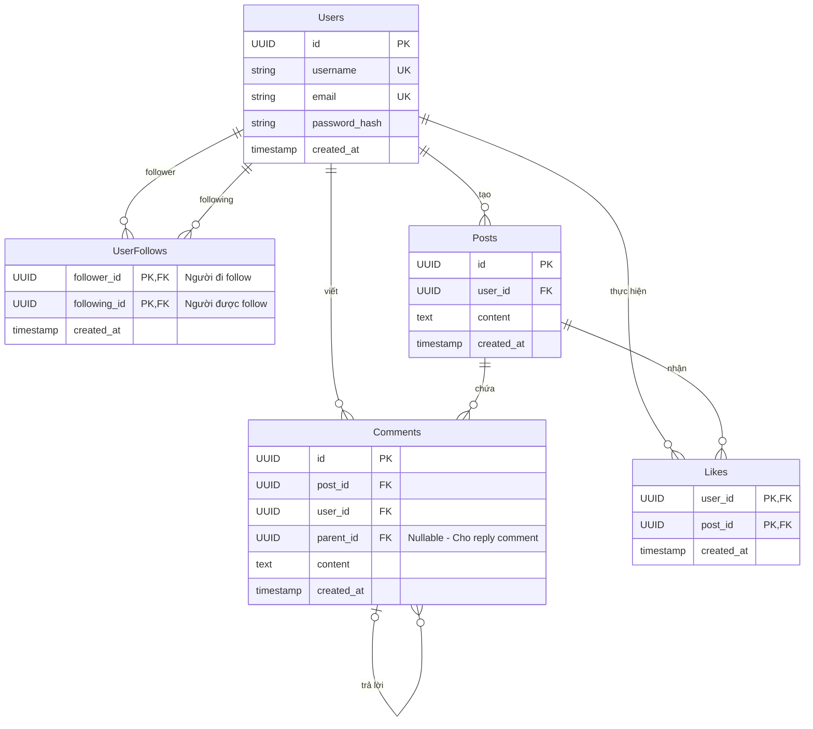

# Social Media App

## Các chức năng MVP
- Xác thực/ Phân quyền: Đăng ký, Đăng nhập
- Bài viết : tạo, xoá , xem bài (chỉ có text, ảnh để sau)
- Follow: follow và unfollow người khác 
- Feed: bài của những người mình follow, sắp xếp theo thời gian, có phân trang
- Tương tác: like và comment

## Các entity chính
- users: Lưu các thông tin của người dùng
- posts: Lưu bài viết của người dùng
- comments: Lưu comment của các bài viết, có thể cải tiến thêm tính năng trả lời 1 comment sau
- likes: lưu like của các bài viết, lưu thêm thông tin của những người like

## Thiết kế ERD

## Kiến trúc sử dụng 
- Layer architecture theo mô hình mvc, có thể cải tiến lên clean architecture nếu hệ thống lớn lên
- Thiết kế API theo chuẩn Restful API

## Các công nghệ sử dụng
- frontend: react, tailwindcss
- backend: spring boot, spring security, spring data jpa
- database: postgresql

## Danh sách các API Endpoints (RESTful chuẩn)

### 1. Xác thực (Auth)
- Đăng ký: POST /api/v1/auth/register
- Đăng nhập: POST /api/v1/auth/login

### 2. Bài viết (Posts)
- Tạo bài viết: POST /api/v1/posts
- Lấy danh sách Feed (có phân trang): GET /api/v1/posts
- Xem danh sách bài viết của 1 tác giả (có phân trang): GET /api/v1/posts/author/{id}
- Cập nhật bài viết: PUT /api/v1/posts/{id} (hoặc PATCH)
- Xóa bài viết: DELETE /api/v1/posts/{id}

### 3. Tương tác Bài viết (Likes & Comments)
- Thích bài viết: POST /api/v1/posts/{postId}/likes
- Bỏ thích bài viết (Unlike): DELETE /api/v1/posts/{postId}/likes
- Lấy danh sách comment của bài: GET /api/v1/posts/{postId}/comments
- Viết comment cho bài: POST /api/v1/posts/{postId}/comments

### 4. Quan hệ người dùng (Users / Follow)
- Follow người khác: POST /api/v1/users/{userId}/follow
- Unfollow người khác: DELETE /api/v1/users/{userId}/follow
- (Tùy chọn) Lấy danh sách người mình đang follow / follower: GET /api/v1/users/{userId}/following